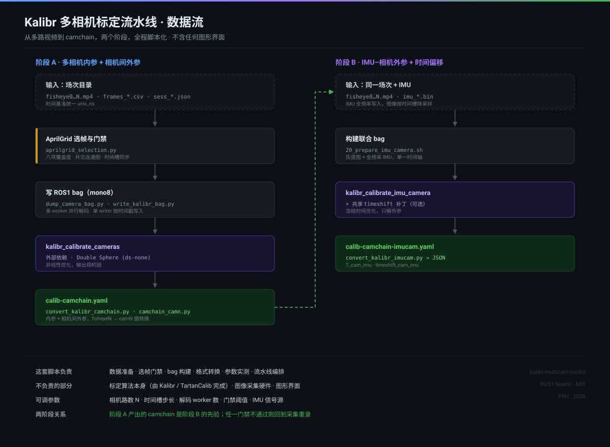

# kalibr-multicam-toolkit

[](https://github.com/yyyrhli/kalibr-multicam-toolkit/actions/workflows/ci.yml)
[](LICENSE)
[](https://www.python.org/)
[](https://wiki.ros.org/noetic)
[](#已知限制)

把 [Kalibr](https://github.com/ethz-asl/kalibr) 这个学术界的标定工具箱，包装成**能批量跑的产线流水线**的一组脚本。

Kalibr 本身很强，但直接拿来标定多相机阵列，会撞上一堆工程问题：bag 的格式必须严格是 `mono8`、时间戳必须全局单调、多相机 camchain 的键名有坑、IMU 噪声参数得自己估、几百个视频文件要挑帧还要保证覆盖度。这套脚本把这些问题都处理掉了，你只需要给一个「视频 + IMU 数据」的目录。

> 定位：这是**准备与编排层**，不重新实现标定算法。真正的优化仍然由 Kalibr / TartanCalib 完成。



**15 个 Python 模块 + 10 个 Shell 脚本 · 约 3400 行 · 零第三方依赖（只用 numpy / OpenCV / PyYAML）**

---

## 功能一览

| 能力 | 入口 | 说明 |
|---|---|---|
| 环境自检 | `scripts/00_check_env.sh` | 检查 ROS1 / Kalibr / Python 依赖是否齐全 |
| OpenCV 4.9 兼容补丁 | `scripts/01_patch_tartancalib_dlt.sh` | 修复 DS 模型 5 点 DLT 崩溃，幂等可重入 |
| 分包拼接 | `python/stitch_packs.py` | 把 `pack_*` 分段录制拼成完整场次 |
| 选帧与门禁 | `python/aprilgrid_selection.py` | AprilGrid 检测 + 八项覆盖度验收，不通过就拒绝 |
| 相机 bag 构建 | `scripts/11_dump_session_bag.sh` | 多路视频 → ROS1 `mono8` bag，时间戳全局有序 |
| 多相机标定 | `scripts/12_run_calibrate_cameras.sh` | 内参 + 相机间外参 |
| 联合 bag 构建 | `scripts/20_prepare_imu_camera.sh` | 灰度图 + 全频率 IMU，单一时间轴 |
| IMU–相机标定 | `scripts/21_run_calibrate_imu_camera.sh` | 外参 + 时间偏移 |
| 共享时间偏移模式 | `python/kalibr_imucam_shared_timeshift.py` | 硬同步多相机，冻结时间优化只解外参 |
| 结果转换 | `python/convert_kalibr_*.py` | Kalibr YAML → 生产用 JSON（含逆矩阵和符号约定） |
| IMU 噪声估计 | `python/imu_rk002.py` | 静置数据实测 → Kalibr 连续时间噪声模型 |
| 模型硬校验 | `python/camera_model.py` | 拒绝非 Double Sphere 配置，避免静默错标 |
| 会话时间对齐 | `python/session_timestamps.py` | 多路丢帧情况下的时间戳一致性 |

---

## 解决的问题

| 痛点 | 这里的做法 |
|---|---|
| 多路视频要写成 ROS1 bag，编码必须是 `mono8`，时间戳要全局有序 | 多 worker 并行解码 + 单 writer 按时间戳写入，带深度限定的预取队列 |
| AprilGrid 检测不稳，超广角下 tag 边缘弯曲导致误检 | 针对广角畸变放宽的检测参数 + 八项覆盖度门禁（象限、网格、尺度、共见连通性） |
| 从几百帧里挑哪些进 bag，挑多了慢、挑少了标定退化 | 时间槽步长 + 归一化观测去重 + 强制保留新覆盖，不设固定帧数上限 |
| Kalibr 的 `kalibr_calibrate_cameras` 输出 `fisheyeN` 键，但 `kalibr_calibrate_imu_camera` 源码里硬编码 `cam0` | 自动做键名转换，并补齐 `rostopic` / `cam_overlaps`，剔除 Kalibr 不认的字段 |
| 多相机硬同步，但官方让它各自估时间偏移，N 路就多出 N 个自由度 | 提供一个共享 timeshift 的补丁模式，冻结时间优化、只解外参 |
| IMU 噪声参数不知道填多少 | 从静置段实测白噪声，按连续时间模型换算，取保守倍数 |

---

## 依赖

**需要预先准备好 ROS1 Noetic + Kalibr（或 TartanCalib）环境。** 这套脚本不安装它们。

- Ubuntu 20.04 / 22.04（ROS1 Noetic）
- Kalibr（或基于它的 TartanCalib 分支，支持 `ds-none` / `ds` 模型）
- Python 3.8+，`numpy`、`opencv-python`、`PyYAML`
- `rosbag`、`rosrun`

运行时入口默认找 `setup/tartan_runtime`，也可以用环境变量指定：

```bash
export KALIBR_RUNTIME=/path/to/your/tartan_runtime
```

`setup/tartan_runtime` 只是一个 conda + catkin 环境的激活包装器，把它指向你自己的 Kalibr 安装即可。

---

## 快速开始

> 输入目录应该长什么样、`frames_*.csv` 各列是什么意思、标定板尺寸怎么填，先看 [examples/README.md](examples/README.md)。时间戳那节建议通读，这是最容易出错的地方。

```bash
git clone <this-repo> && cd kalibr-multicam-toolkit

# 1. 自检环境
bash scripts/00_check_env.sh

# 2. （如果 Kalibr 基于 OpenCV 4.9）打一次幂等兼容补丁
bash scripts/01_patch_tartancalib_dlt.sh

# 3. 开新终端，激活运行时
KR=$(pwd)
source "$KR/setup/source_kalibr.sh"
```

### 多相机内参 + 相机间外参

场次目录里放 `fisheye0 … fisheyeN` 的视频和 `frames_*.csv`：

```bash
SESS=/path/to/session
OUT=$SESS/kalibr_export

bash $KR/scripts/11_dump_session_bag.sh \
  --session-dir "$SESS" --out-dir "$OUT" \
  --stride 10 --bag-camera-workers 4 --bag-queue-depth 2

bash $KR/scripts/12_run_calibrate_cameras.sh --export-dir "$OUT"
# 产物：$OUT/calib-camchain.yaml
```

### IMU–相机联合标定

先有上一步的 camchain，然后：

```bash
CHAIN=$OUT/calib-camchain.yaml
IMU_OUT=$SESS/kalibr_imu_export

bash $KR/scripts/20_prepare_imu_camera.sh \
  --session-dir "$SESS" --camchain "$CHAIN" --out-dir "$IMU_OUT" \
  --stride 10 --bag-camera-workers 4 --bag-queue-depth 2 --imu-signal raw

bash $KR/scripts/21_run_calibrate_imu_camera.sh --export-dir "$IMU_OUT"
# 产物：$IMU_OUT/calib-camchain-imucam.yaml
```

### 只估 IMU 噪声

静置一段数据，用 `python/imu_rk002.py` 的 `load_imu` / `write_imu_yaml` 直接生成 Kalibr 的 `imu.yaml`。详见 `INSTALL.md`。

---

## 四个值得单独说的点

### 1. camchain 键名是个坑

Kalibr 两个阶段对 camchain 顶层键的要求**不一样**：

- `kalibr_calibrate_cameras` 输出 `fisheye0 / fisheye1 / …`
- `kalibr_calibrate_imu_camera` 的源码里**硬编码读 `data['cam0']`**

不转换就会在联合阶段直接崩。`python/camchain_camn.py` 做转换，而且要连带补 `rostopic`（必须和 bag 里的 topic 一致）、补 `cam_overlaps`，并**删掉** `camera_name` / `camera_overlaps`——Kalibr 的 camchain schema 不认这两个键。

### 2. 共享时间偏移

官方 `kalibr_calibrate_imu_camera` 给每路相机一个独立的 `cameraTimeToImuTimeDv`。如果多相机是**硬同步**的（同一个触发源），让优化器各自去估，等于给了它 N 个可以互相推诿的自由度，容易过拟合。

`python/kalibr_imucam_shared_timeshift.py` 用 monkey-patch 把 `IccCalibrator.buildProblem` 里的所有相机 `timeshiftCamToImuPrior` 设成同一个值，并强制 `noTimeCalibration=True`：

```python
def wrapped(self, *args, **kwargs):
    kwargs["noTimeCalibration"] = True
    for cam in self.CameraChain.camList:
        cam.timeshiftCamToImuPrior = shared_shift
    return orig(self, *args, **kwargs)
```

自由度少 N 个，外参更稳。**代价**：这个常量必须事先知道，通过环境变量 `KALIBR_SHARED_TIMESHIFT_S` 传入。

> ⚠️ 这个值是外部依赖，不是脚本估出来的。设备固件、IMU 驱动打戳、滤波器配置变了，它都会变。**而 Kalibr 不会因此报错**——它会用错误的值继续优化，外参吸收掉一部分误差，重投影误差依然好看。建议先跑一次自由模式，看各路估出来的偏移是否一致，再取均值固化。

### 3. IMU 噪声要从数据里算，不是抄默认值

Kalibr 用的是**连续时间噪声模型**（noise density），不是离散标准差：

```
noise_density = std(静置段) / sqrt(sample_rate)
```

`python/prepare_kalibr_imu_ros.py` 从静置数据实测标准差，换算成 noise density 再写 `imu.yaml`。白噪声取实测的 2 倍（保守），random walk 用典型 MEMS 先验——后者没有实测，是个明示的简化。

另外它**不估加速度计零偏**：单一未知静止姿态下，三轴加速度 bias 和重力方向无法分离，硬估就是伪造。只记录重力向量作为诊断。

### 4. 选帧门禁：宁可拒绝，不要凑数

`python/aprilgrid_selection.py` 在把帧写进 bag 之前，要求同时满足：

- 单帧至少 6 个唯一 tag（OpenCV 4.9 的 DLT 硬要求）
- 标定板最小面积占比
- 每路相机最少有效帧数
- 板中心覆盖的象限数
- 画面网格覆盖率
- 近/远尺度变化
- **多相机共见关系形成连通图**（没有共见就没有相机间外参）
- 同一时间槽内各路时间戳的两两跨度不超过同步门限

检测参数针对广角做了放宽（`polygonalApproxAccuracyRate` 从 0.05 放到 0.12，`errorCorrectionRate` 从 0.6 放到 1.0），因为超广角下 tag 直边是弯的，用默认参数会大量漏检。

但**预选阶段不做严格拒绝**——重复 ID 不整帧丢弃，避免把正常视图误删，真正的重复板交给 Kalibr 判定。

---

## 目录结构

```
kalibr-multicam-toolkit/
├── scripts/
│   ├── 00_check_env.sh                 环境自检
│   ├── 01_patch_tartancalib_dlt.sh     OpenCV 4.9 的 DS/DLT 兼容补丁
│   ├── 11_dump_session_bag.sh          相机 bag（mono8）
│   ├── 12_run_calibrate_cameras.sh     多相机内参 + 外参
│   ├── 20_prepare_imu_camera.sh        联合 bag（灰度 + 全频率 IMU）
│   └── 21_run_calibrate_imu_camera.sh  IMU–相机联合标定
├── python/
│   ├── aprilgrid_selection.py          选帧与覆盖度门禁
│   ├── prepare_kalibr_imu_ros.py       IMU 预处理与 imu.yaml 生成
│   ├── convert_kalibr_camchain.py      Kalibr camchain → 生产格式
│   ├── convert_kalibr_imucam.py        联合结果 → JSON（含外参和时间偏移）
│   ├── camchain_camn.py                fisheyeN → camN 键名转换
│   ├── camera_model.py                 相机模型硬校验（ds / ds-none）
│   ├── imu_rk002.py                    二进制 IMU 解析与噪声估计
│   ├── kalibr_imucam_shared_timeshift.py  共享时间偏移补丁
│   ├── session_timestamps.py           会话时间戳对齐
│   ├── stitch_packs.py        分包拼接
│   ├── dump_camera_bag.py / write_kalibr_bag.py   bag 构建
│   └── rewrite_bag_imu_raw.py          改写 bag 里的 IMU 数据
├── config/
│   ├── aprilgrid_6x6.yaml              AprilGrid 标定板定义（示例值）
│   └── imu.yaml.example                IMU 噪声参数模板
├── docs/                               1–5 步流程说明 + 加速 A/B 实验方法
└── setup/                              运行时激活脚本
```

---

## 已知限制

- **只支持 Linux**。依赖 ROS1 和 `rosbag`，没有 Windows / macOS 路径。
- **不做视觉前端**。bag 里的图像要自己准备（本工具提供从 MP4 解码的路径）。
- **`ds` 模型是硬校验**：`camera_model.py` 会拒绝非 Double Sphere 的配置。如果你的系统用 pinhole + radtan，需要自己改这个文件。
- **共享 timeshift 模式假设硬同步**，脚本不验证这个假设是否成立。
- **`imu_rk002.py` 绑定了一种自定义二进制格式**（72 字节头 + 152 字节记录的 `RKIMU002`）。换 IMU 采集方案要改这个文件。

---

## License

MIT（见 `LICENSE`）。

使用的第三方组件各自遵循其许可证：Kalibr 为 BSD，TartanCalib 部分基于 Kalibr，OpenCV 为 Apache-2.0。
